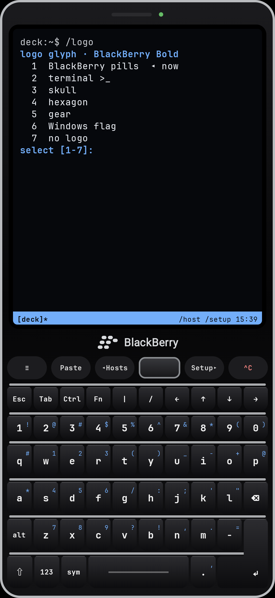
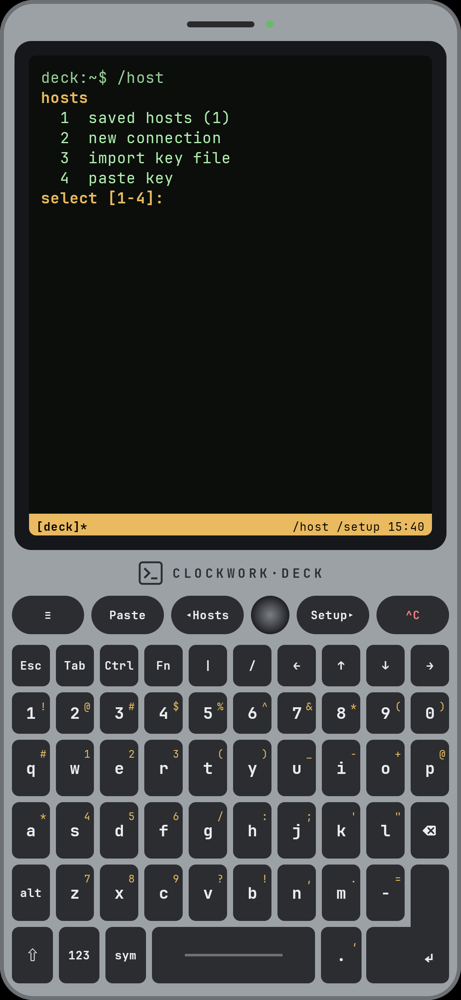
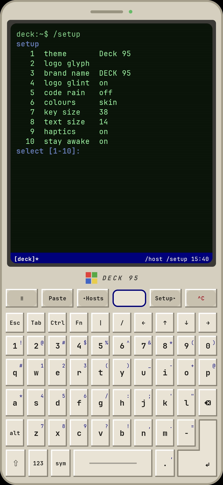
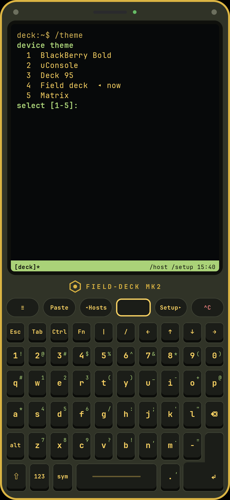
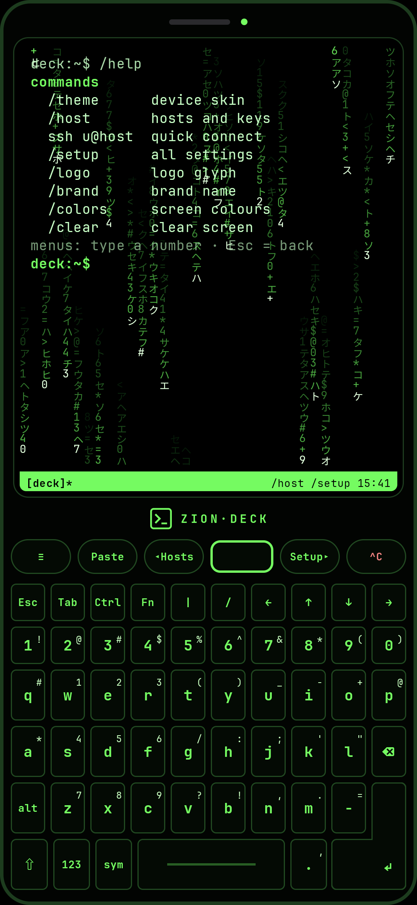

# Deck SSH

An Android SSH client that turns your phone into a cyberdeck. The keyboard is part of the device and always on screen, and the phone's own keyboard never pops up.

| BlackBerry Bold | uConsole | Deck 95 | Field deck | Matrix |
|---|---|---|---|---|
|  |  |  |  |  |

## Features

- **Built-in hardware-style keyboard** that takes at least 45% of the screen. It has a function row, a Samsung-style number row, a big L-shaped Enter key, BlackBerry alt legends, a numpad layer, F1–F12 and a trackpad or trackball for arrow keys. Every press lights the key up in the skin colour, pushes it down and vibrates, and there is an optional click sound (`/click`).
- **Five device skins:** BlackBerry Bold, uConsole, Deck 95, Field deck and Matrix (with code rain behind the terminal). The logo glyph and brand name can be changed, and the logo glints.
- **Everything is typed.** With no session open, the screen is a console with numbered menus:

  | Command | What it does |
  |---|---|
  | `/theme` | pick a device skin (1–5) |
  | `/host` | 1 saved hosts · 2 new connection · 3 import key file · 4 paste key, then save or connect |
  | `ssh user@host -p 22` | quick connect |
  | `/setup` | all settings, numbered |
  | `/logo`, `/brand`, `/colors` | logo glyph, brand name, 87 screen colour palettes |

- **SSH:** password or private key (ed25519, RSA, ECDSA via BouncyCastle), multiple tabs in a tmux-style status line, and xterm-256 colour through the Termux terminal emulator. Pinch the terminal to zoom.
- **Secure storage:** saved passwords and keys are encrypted with an Android Keystore AES-GCM key.
- Works with a Bluetooth or USB keyboard too.

## Install

Download `DeckSSH.apk` from [Releases](../../releases) and open it on your phone (Android 10 or newer).

## Build

```bash
./gradlew assembleRelease
```

Kotlin, Jetpack Compose, [JSch (mwiede)](https://github.com/mwiede/jsch) and the [Termux terminal emulator](https://github.com/termux/termux-app). Theme rules are in [THEME.md](THEME.md).
